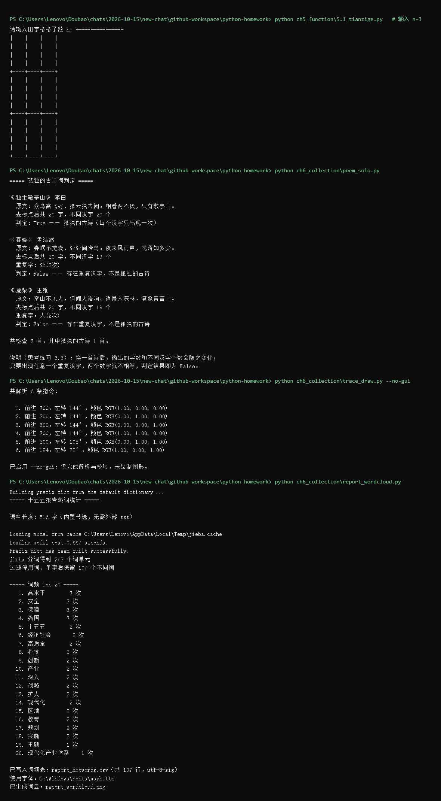

# 实验报告：Python 课堂作业合集（第 5~6 章）

| 项目 | 内容 |
| --- | --- |
| 课程 | Python 程序设计 |
| 内容 | 第 5 章 函数与代码复用、第 6 章 组合数据类型 课堂作业 |
| 姓名 / 学号 | ________ / ________ |
| 完成日期 | 2026-11-18 |
| 仓库地址 | https://github.com/qls-eng/python-homework |
| 运行环境 | Windows 11 + Python 3.13.18（第 6 题另需 jieba、wordcloud、matplotlib） |

## 一、作业清单

| 序号 | 题目 | 文件 | 核心知识点 |
| --- | --- | --- | --- |
| 1 | `if __name__ == '__main__':` 的含义，why？ | `notes/if_name_main.md` | 模块入口、直接运行与导入的区别 |
| 2 | 习题 5.1 字符田字格绘制 | `ch5_function/5.1_tianzige.py` | 自定义函数、参数控制、循环嵌套 |
| 3 | 绘制科赫雪花（0~4 阶） | `ch5_function/koch_snowflake.py` | 递归、turtle 绘图 |
| 4 | 蒙特卡罗方法手搓图形 | `ch5_function/monte_carlo.py` | 随机数、概率估算 π、散点绘制 |
| 5 | 孤独的古诗词（教材 P205 代码 6A） | `ch6_collection/poem_solo.py` | 字符串处理、集合去重判定 |
| 6 | "十五五"规划报告热词统计 + 词云 | `ch6_collection/report_wordcloud.py` | jieba 分词、词频统计、中文字体处理 |
| 7 | 自动轨迹绘制 | `ch6_collection/trace_draw.py` | 指令解析、参数校验、turtle 转向与颜色 |

> 全部脚本统一用 `if __name__ == '__main__':` 作为入口，导入时不自动执行——这本身就是第 1 题要说明的问题。

## 二、逐题说明与结果

### 2.1 第 1 题：`if __name__ == '__main__'` 的含义

完整笔记见 `notes/if_name_main.md`，核心结论：

- 每个模块都有内置变量 `__name__`；被直接运行时它的值是 `"__main__"`，被 `import` 时它的值是模块名。
- 因此 `if __name__ == '__main__':` 包住的代码只在"直接运行该文件"时执行，被导入时不执行。
- 作用有两层：一是避免导入模块时顺带执行测试代码 / 绘图代码；二是让文件同时具备"可复用模块"与"可独立运行脚本"两种身份。

### 2.2 第 2 题：字符田字格（习题 5.1）

思路：把田字格拆成两种重复单元——横向线 `+----` 与纵向线 `|    `，再用两层循环按"上边 + 4 行内部"的方式拼出 n×n 格。

关键代码：

```python
horizontal = "+----" * n + "+"
vertical = "|    " * n + "|"

for _ in range(n):
    print(horizontal)
    for _ in range(4):
        print(vertical)
print(horizontal)
```

运行（n = 3）结果：



（截图第一段即 n=3 的田字格：3×3 格、每格 4 行高，横向与纵向线条完整闭合。）

**参数校验**：`n` 不是正整数时打印"宽度必须为大于 0 的正整数"并返回，不画图也不抛异常。

### 2.3 第 3 题：科赫雪花（递归）

思路：科赫曲线的一阶变换是"把一条线段替换成 4 条更短的线段"，每次长度缩为 1/3；递归到 0 阶即为一条直线。

关键点：

- 递归基线：`if order == 0: forward(length); return`
- 递归体：`forward(l/3) → left(60) → forward(l/3) → right(120) → forward(l/3) → left(60) → forward(l/3)`
- 雪花 = 把三条科赫曲线首尾相接，每次转向 120°。

交互式输入阶数 0~4，阶数越高线条越密（4 阶片段数 4⁴ = 256）。

> 图形窗口类脚本（本题与第 4、7 题的绘图部分）运行时会弹出 turtle 窗口，需要人工查看与关闭；本报告的命令行截图覆盖的是可文本输出的部分，图形效果以现场运行窗口为准。

### 2.4 第 4 题：蒙特卡罗方法估算 π

思路：在边长 2 的正方形内随机投点，落在内切圆（半径 1）内的点数占比 ≈ 圆面积 / 正方形面积 = π/4，于是 π ≈ 4 × 命中率。

```python
for _ in range(total):
    x, y = random.uniform(-1, 1), random.uniform(-1, 1)
    if x * x + y * y <= 1:
        hits += 1
pi_est = 4 * hits / total
```

点越多结果越接近 3.14159；同时把命中点与未命中点用不同颜色画出，直观呈现"面积比 ≈ 概率比"。

### 2.5 第 5 题：孤独的古诗词（P205 代码 6A）

题目要求判断一首诗是否为"孤独的古诗"：去掉标点后，每个汉字只出现一次，即 `len(诗) == len(set(诗))`。

关键代码：

```python
chars = re.sub(r"[^\u4e00-\u9fa5]", "", poem)
is_unique = len(chars) == len(set(chars))
```

本次运行检查三首，结果见截图第二段：

| 诗 | 去标点字数 | 不同汉字数 | 重复字 | 判定 |
| --- | --- | --- | --- | --- |
| 《独坐敬亭山》李白 | 20 | 20 | 无 | True（孤独的古诗） |
| 《春晓》孟浩然 | 20 | 19 | 处（2 次） | False |
| 《鹿柴》王维 | 20 | 19 | 人（2 次） | False |

**思考练习 6.3 的结论**：换一首诗后两个数字会随之变化，只要出现任意一个重复汉字，`len` 与 `len(set)` 就不再相等，判定即为 False。

### 2.6 第 6 题："十五五"规划报告热词 + 词云

流程：内置语料 → jieba 分词 → 过滤停用词与单字 → 词频统计 → wordcloud 生成词云图。

真实运行数据（见截图第四段）：

- 语料长度 516 字（节选内置在 `TEXT` 常量中，不依赖外部 txt）；
- 分词得到 263 个词单元，过滤后保留 107 个不同词；
- 词频 Top 3 为"高水平、安全、保障"，各出现 3 次；
- 输出 `report_hotwords.csv`（107 行，utf-8-sig）与 `report_wordcloud.png`；
- 使用字体 `C:\Windows\Fonts\msyh.ttc`——中文字体必须显式指定，否则汉字会变成方框。

生成的词云图：


### 2.7 第 7 题：自动轨迹绘制

题目给 6 条指令（前进距离、左转角度、颜色 RGB），要求解析后画出彩色轨迹。

指令格式示例：`300,0,144,1,0,0`（距离、转向标志、角度、R、G、B）。

解析与校验要点：

- 每行必须 6 个字段，缺项 / 非数字时提示该行被跳过，不中断整体；
- 转向标志 0 = 左转、1 = 右转；
- 颜色分量除以 255 归一化后交给 `turtle.pencolor`。

本次用 `--no-gui` 只做解析验证（截图第三段）：6 条指令全部解析成功，角度依次为 144°×4、108°、72°，与题目给出的五角星类轨迹一致；加 `--no-gui` 时明确提示"仅完成解析与校验，未绘制图形"。

## 三、运行方式与依赖

```bash
pip install -r requirements.txt

python ch5_function/5.1_tianzige.py          # 输入格子数 n
python ch5_function/koch_snowflake.py        # 弹出窗口，输入 0~4 阶
python ch5_function/monte_carlo.py           # 弹出窗口，输入投点数
python ch6_collection/poem_solo.py
python ch6_collection/report_wordcloud.py    # 生成 csv + png
python ch6_collection/trace_draw.py           # 弹窗绘制
python ch6_collection/trace_draw.py --no-gui  # 只解析
```

第 2、3、5、7 题只用标准库；第 6 题需 `jieba`、`wordcloud`、`matplotlib`。

## 四、问题与解决

| 问题 | 现象 | 处理 |
| --- | --- | --- |
| 田字格线条错位 | 第一次写时把"上边"和"内部竖线"混在一层循环，格子高度不对 | 拆成"外层画 n 次格子上边 + 内层画 4 行竖线"，最后补一条底边 |
| 科赫雪花递归爆炸 | 阶数传大后片段数指数增长，绘制极慢 | 交互输入限制 0~4 阶，并在提示中说明阶数与线段数的关系 |
| 词云汉字显示方框 | wordcloud 默认字体不含中文 | 按候选列表依次探测 `msyh.ttc`、`simhei.ttf`、`simsun.ttc`，找不到时只输出词频并提示 |
| CSV 在 Excel 中乱码 | 默认 utf-8 无 BOM，Excel 按 GBK 解析 | 用 `utf-8-sig` 写盘 |
| 终端一次输错就崩 | `int(input())` 遇到非数字直接抛 ValueError | 校验失败时打印提示并返回，不抛异常 |

## 五、小结

- 函数化后，田字格从"固定 3 格"变成"n 格"，参数化是代码复用的第一步。
- 递归的关键是先写清基线条件，再写"把问题缩小一阶"的递归体；科赫雪花是典型例子。
- 组合数据类型的选择直接影响写法：判断"是否有重复"用 `set` 一行搞定，比写计数循环简洁得多。
- 中文文本处理有两个必踩的坑：分词需要词典（jieba）、绘图需要中文字体（wordcloud 的 `font_path`）。

## 六、交付物

| 交付物 | 位置 |
| --- | --- |
| 各题源码 | `ch5_function/`、`ch6_collection/` 共 6 个脚本 |
| 笔记 | `notes/if_name_main.md` |
| 运行截图 | `docs/images/run_output.png`（第 2、5、6、7 题命令行输出） |
| 词云产物 | `docs/images/report_wordcloud.png`、`docs/images/report_hotwords.csv` |
